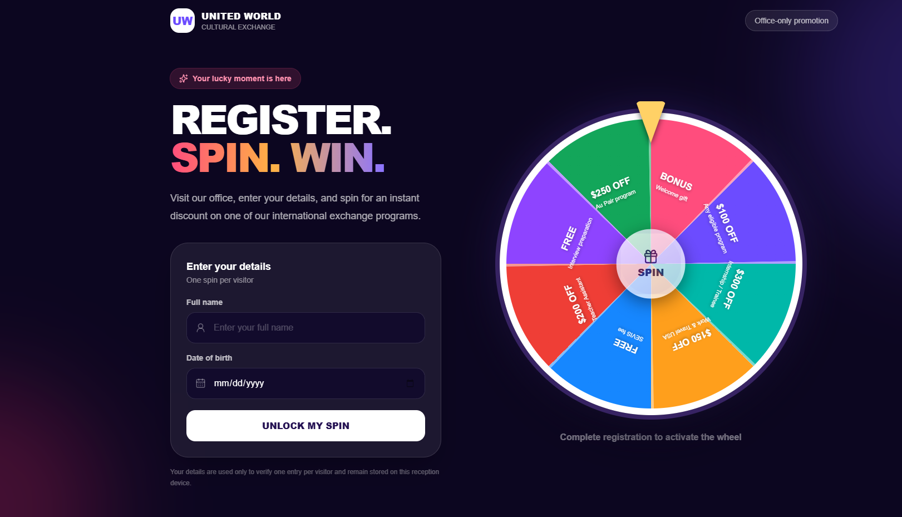
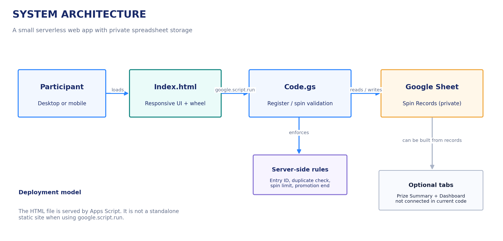
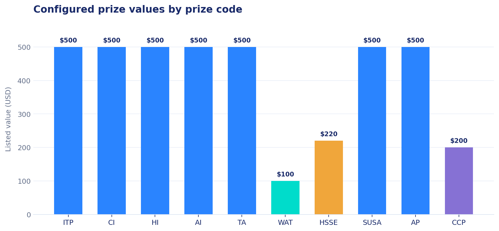
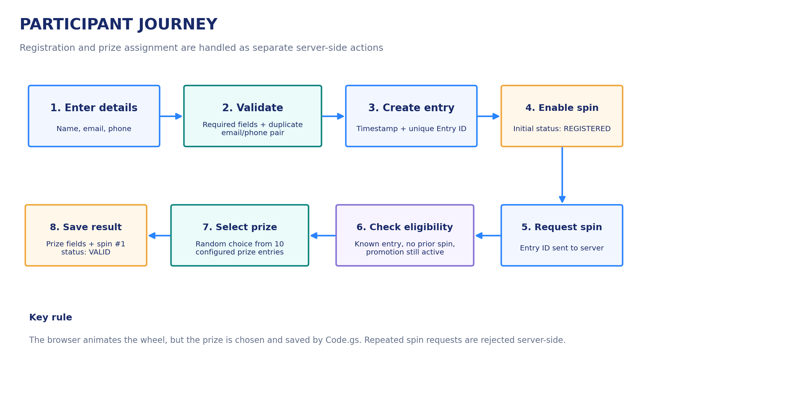
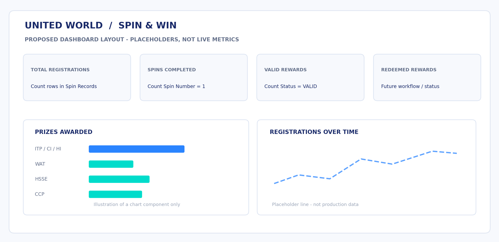

# United World - Spin & Win

> A responsive promotional web experience for United World LLC, built with Google Apps Script and Google Sheets.



**Project type:** promotional microsite + server-side registration and prize assignment  
**Frontend:** HTML, CSS, JavaScript  
**Backend:** Google Apps Script (`Code.gs`)  
**Data store:** private Google Sheet (`Spin Records`)  
**Primary brand colors:** `#192A69`, `#2A84FF`, `#00F0DA`

## Purpose

The campaign invites visitors to register with their name, email, and phone number, then spin a visual prize wheel for an instant program discount. It was built to make the promotional flow feel engaging on desktop and mobile while keeping prize selection and eligibility checks on the server rather than trusting the browser.

The working application is hosted by Google Apps Script. Because the HTML uses `google.script.run`, opening `Index.html` as a local file or serving it with `python -m http.server` is for layout inspection only; the registration and spin functions require the HTML to be served from Apps Script.

> **Live deployment:** [Open the current web app](https://script.google.com/macros/s/AKfycbzSO_tJN5pX2Lor6yvI9LrDtYIZC-5VqqkDEPJIuZUNTPwCjl573VAdW7L1JBw-h68q/exec). This is the production endpoint: submissions may be written to the connected live spreadsheet. Do not use it for testing with dummy contact details.

## Features in the current implementation

- Responsive desktop and mobile layout, with explicit mobile-device layout handling.
- Registration fields for full name, email, and phone.
- Server-generated Entry ID and timestamp.
- Duplicate registration check when **both** the email and phone match an existing record.
- Server-side prize selection from 10 configured prize entries.
- Server-side one-spin limit and promotion end-date check.
- Result saved to Google Sheets with prize code, prize label/value, spin count, validity date, and status.
- `LockService` around registration/spin operations to reduce concurrent write conflicts.
- Reward modal and program information in the UI.

## Architecture



1. `Index.html` renders the responsive participant experience.
2. The browser calls Apps Script functions using `google.script.run`.
3. `Code.gs` validates input, finds the registered entry, applies the promotion rules, selects a prize, and writes the result.
4. The private `Spin Records` tab is the system of record.

The spreadsheet also contains `Prize Summary` and `Dashboard` tabs in the current workbook. **The current `Code.gs` does not read or update those two tabs.** They are reserved for future reporting/visualization work.

## Configured prize pool

| Code | Displayed prize | Listed value |
|---|---|---:|
| ITP | ITP - $500 | $500 |
| CI | CI - $500 | $500 |
| HI | HI - $500 | $500 |
| AI | AI - $500 | $500 |
| TA | TA - $500 | $500 |
| WAT | WAT - $100 | $100 |
| HSSE | HSSE - SEVIS FEE $220 | $220 |
| SUSA | SUSA - $500 | $500 |
| AP | AP - $500 | $500 |
| CCP | CCP - $200 | $200 |

The backend selects one of these 10 array entries using `Math.floor(Math.random() * PRIZES.length)`. Since each array entry appears once, each entry has an equal nominal selection chance in the current implementation. This is not a cryptographic random draw or a guarantee of independent real-world outcomes; treat the chart in this repository as a view of configured prizes, not historical results.



## Repository structure

```text
united-world-spin-win/
├── apps-script/
│   ├── Code.gs                  # Server-side validation and prize logic
│   └── Index.html               # Responsive UI served by Apps Script
├── assets/
│   └── united-world-logo.jpg
├── screenshots/
│   ├── desktop-preview.png
│   ├── mobile-preview.jpg
│   └── google-sheet-tabs.png
├── docs/
│   ├── PROJECT_GUIDE.pdf        # Step-by-step project handbook
│   ├── architecture.png
│   ├── participant-flow.png
│   ├── prize-values.png
│   └── dashboard-concept.png
├── .gitignore
└── README.md
```

## Set up the Google Sheet and Apps Script

### 1. Prepare the spreadsheet

Create or open the spreadsheet that should own the web app's records. Create a tab named exactly `Spin Records`. Set row 1 to these 11 headers in this order:

`Timestamp | Entry ID | Full Name | Email | Phone | Prize Code | Prize | Prize Value | Spin Number | Valid Until | Status`

Keep the workbook and tab private to the people who administer the promotion. The app stores contact information, so do not publish the sheet or include production rows in a public repository.

### 2. Open the bound Apps Script project

From the spreadsheet, go to **Extensions → Apps Script**. This creates/opens the script bound to the spreadsheet; `SpreadsheetApp.getActiveSpreadsheet()` relies on that relationship.

### 3. Add the source files

- Paste `apps-script/Code.gs` into the script editor's `Code.gs` file.
- Create an HTML file named exactly `Index` (Apps Script shows `Index.html`) and paste `apps-script/Index.html` into it.
- Save both files.

### 4. Deploy as a web app

In Apps Script, select **Deploy → New deployment**. Choose **Web app**, set the intended execution identity and access policy for your audience, then deploy. Review Google's current access choices carefully: public access may allow anyone with the URL to submit data. Authorize the requested spreadsheet/script access.

For an existing deployment, use **Deploy → Manage deployments**, edit the web app deployment, select a new version, and deploy. A versioned update generally keeps the same `/exec` URL for that deployment. Test the deployed app URL, not the editor preview.

### 5. End-to-end test

Use a separate test spreadsheet/deployment before testing a production campaign. Confirm that a test registration adds one row with `REGISTERED`, a first spin fills the prize columns and changes status to `VALID`, and a second spin request is rejected. Check the result in the sheet and test on a phone as well as a desktop browser.

## How the participant flow works



1. The visitor enters name, email, and phone.
2. `registerParticipant()` trims the values and checks whether the exact email + phone pair already exists.
3. A new record gets an ID similar to `UW-YYYYMMDD-000123` and status `REGISTERED`.
4. The visitor requests one spin with that Entry ID.
5. `spinWheel()` checks the promotion end date, entry ID, and prior spin count.
6. One prize entry is selected, persisted to columns F-J, and the status becomes `VALID`.
7. The browser shows the result.

## Data dictionary

| Column | Purpose |
|---|---|
| Timestamp | Registration timestamp |
| Entry ID | Server-generated participant reference |
| Full Name | Participant name |
| Email | Lowercased email used in duplicate check |
| Phone | Trimmed phone string used in duplicate check |
| Prize Code | Short prize identifier |
| Prize | Display name for the selected prize |
| Prize Value | Configured numeric value |
| Spin Number | `0` before the spin, `1` after a successful spin |
| Valid Until | Promotion end date |
| Status | `REGISTERED` or `VALID` in the current code |

`REDEEMED` is a possible future status, not a workflow currently implemented by `Code.gs`.

## Operational notes and current limits

- The promotion end date is set in `PROMOTION_END` to February 1, 2027, at 00:00 Mongolia time (`+08:00`). Update the date intentionally if campaign rules change.
- The backend stores a single spin count. It does not currently implement a staff redemption screen or transition status to `REDEEMED`.
- The duplicate check requires both email and phone to match. It is not identity verification and does not prevent someone registering with altered contact details.
- The prize list and prize values are in source code. Review both the wheel display and the server list if prizes change.
- The included `doPost()` supports JSON actions but the shipped HTML uses Apps Script's `google.script.run` bridge for normal interaction.
- Protect spreadsheet access and limit who can edit/deploy the Apps Script project. Keep backups before changes.

## Suggested project walkthrough

1. **Inspect the UI:** open `apps-script/Index.html` and locate the registration, wheel, program section, and reward modal.
2. **Inspect server logic:** in `apps-script/Code.gs`, find `registerParticipant()`, `spinWheel()`, `getSheet()`, and the `PRIZES` array.
3. **Trace a record:** follow a new participant from the form into the `Spin Records` columns.
4. **Test the boundaries:** test duplicate registration, missing fields, unknown Entry ID, repeated spin, and expired promotion.
5. **Add reporting:** use a separate sheet/formula/dashboard approach to summarize data without changing the record-writing path until tested.

## Optional reporting dashboard

The proposed `Dashboard` design below is a visual concept only; it does **not** show live metrics, and current Apps Script code does not populate it. Build it from aggregated counts in `Spin Records` when ready. Keep the original record sheet as the source of truth.



Recommended future measures include total registrations, spins completed, prize counts, registration trend by day, valid rewards, and redeemed rewards after a redemption workflow is added.

## Publish this project to GitHub

The source package is ready to upload, but no GitHub repository has been created automatically from this workspace. To publish it under your account:

1. Sign in to GitHub and create a **new empty repository** named `united-world-spin-win` (do not initialize another README, license, or `.gitignore`).
2. Download and extract the repository ZIP from the conversation.
3. Open a terminal in the extracted `united-world-spin-win` folder.
4. Run the commands below, replacing `YOUR_USERNAME` with your GitHub username:

```bash
git init
git add .
git commit -m "Initial project showcase"
git branch -M main
git remote add origin https://github.com/YOUR_USERNAME/united-world-spin-win.git
git push -u origin main
```

5. On GitHub, open `README.md` and confirm images render. Uploads include the documentation PDF and screenshots.

Before setting a repository to public, review all contents and your organization's policies. This package contains source and demo screenshots, not the Google Sheet's participant rows or script credentials. Keep any live spreadsheet private. If you want the code private, choose a private repository instead.

## Local visual inspection

You may run a local static server to inspect layout-only HTML:

```bash
python -m http.server 8000
```

Then open `http://localhost:8000/apps-script/Index.html` from a compatible browser. The Apps Script functions will not work from local hosting because `google.script.run` is only available inside Apps Script HTML Service. Stop the local server with `Ctrl+C` when done.

## Project status

The current published web app has been tested end-to-end by the project owner and the final mobile layout was reported as working. This repository is a documentation snapshot of that implementation; always re-test a fresh deployment before relying on it for a live campaign.
